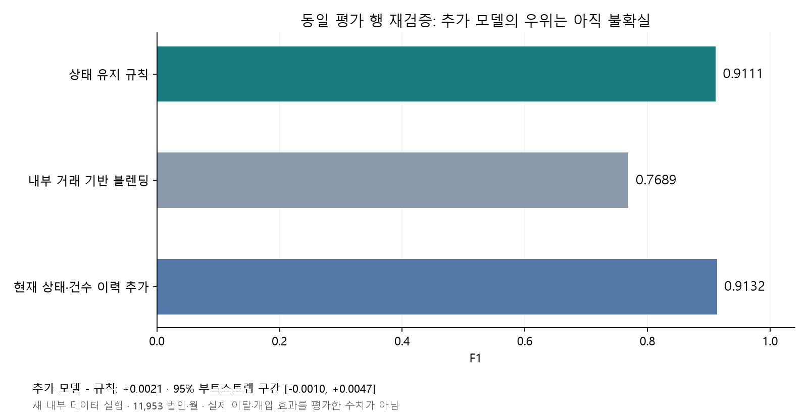
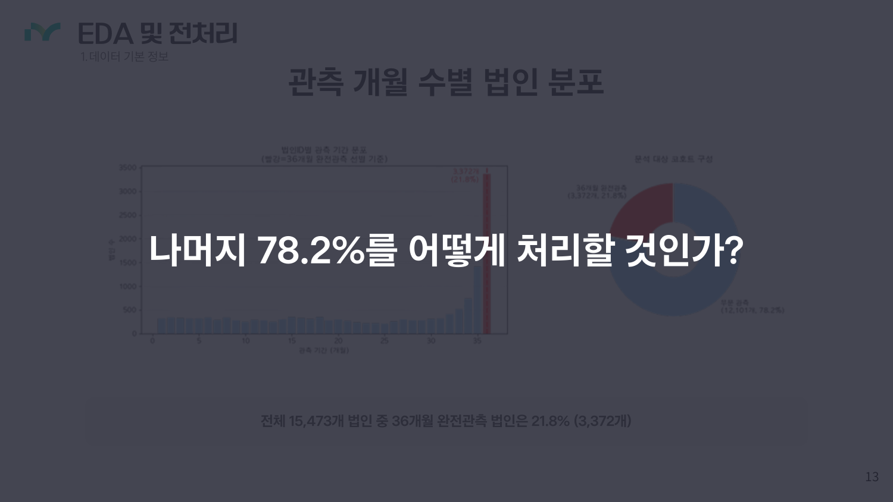
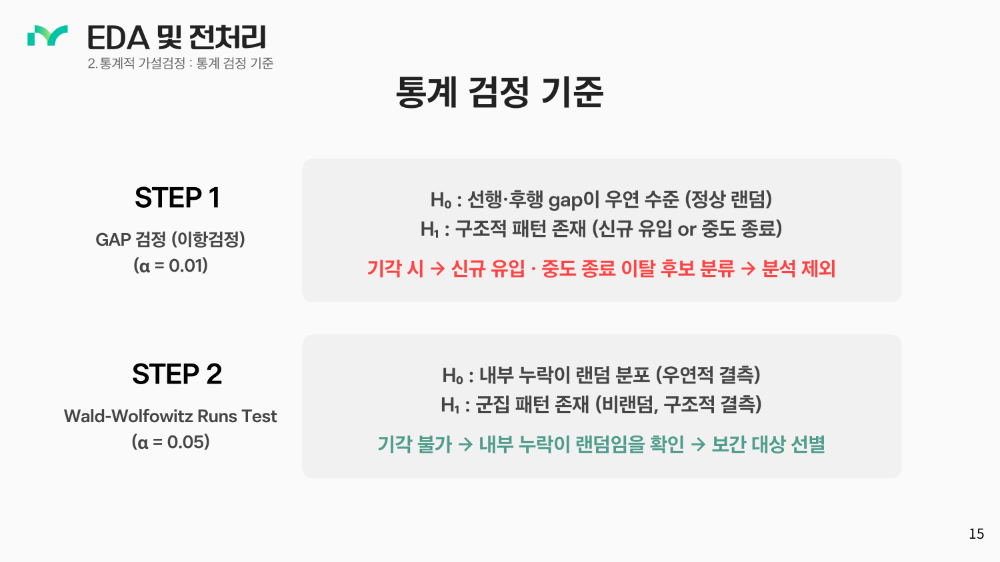
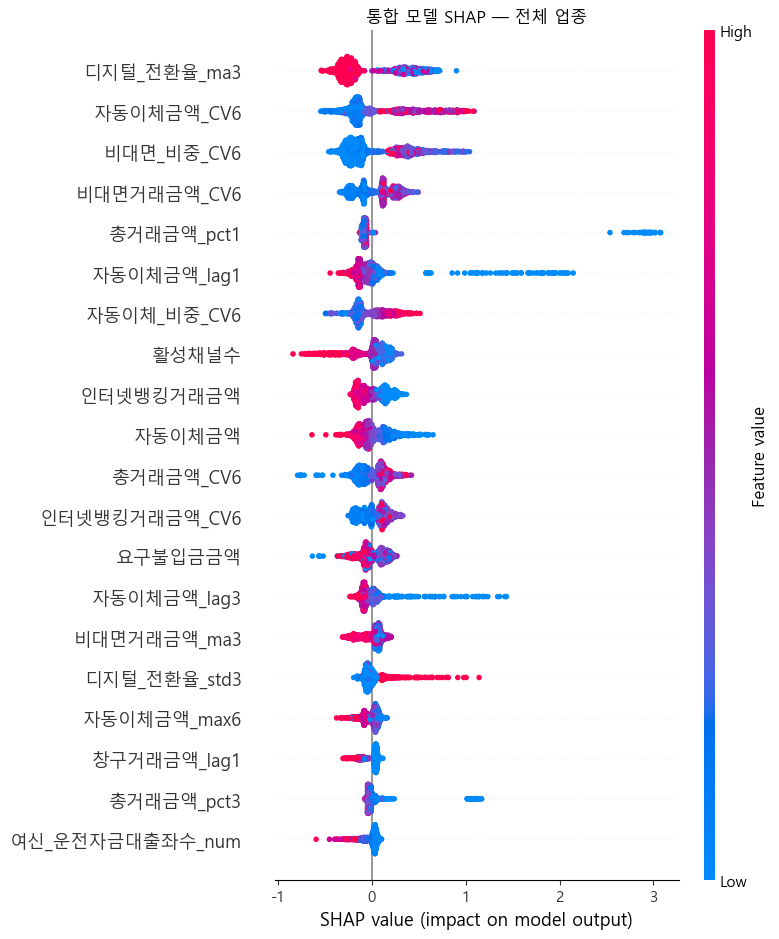
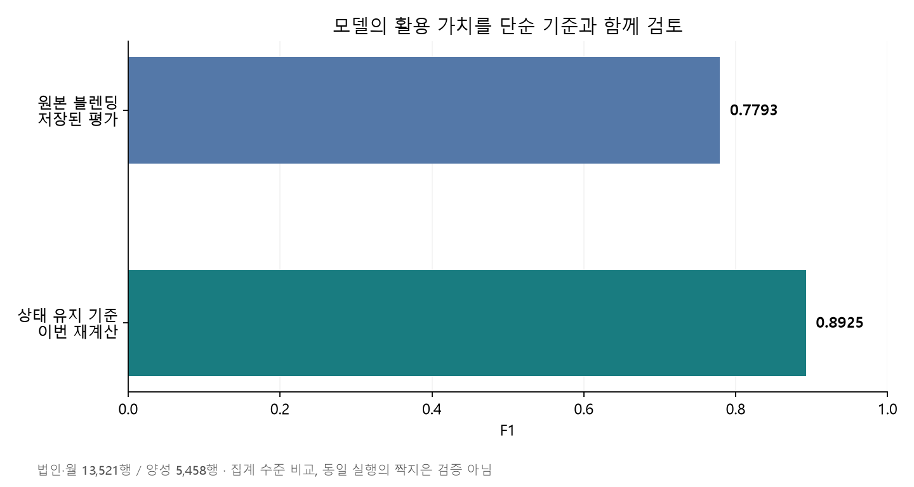
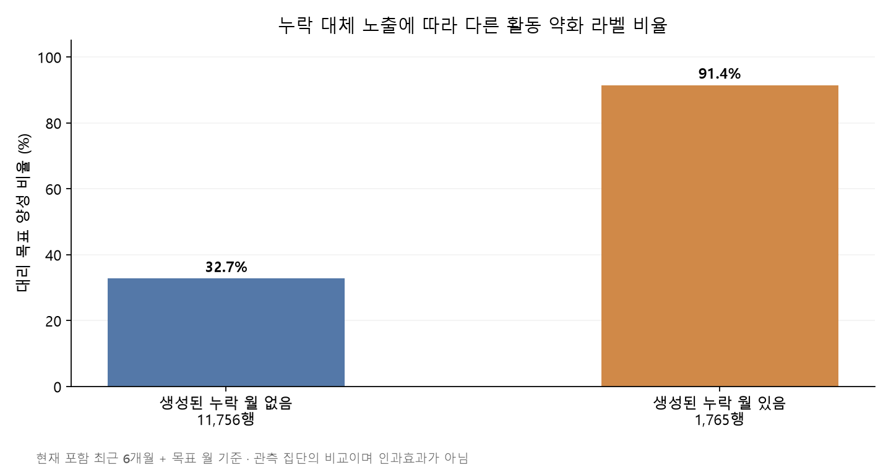
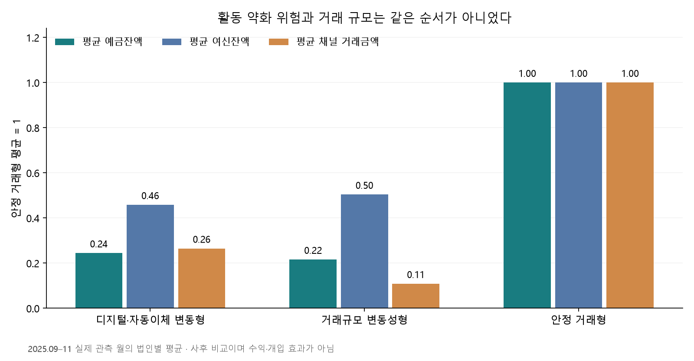

# iM뱅크 법인 고객 거래활동 약화 분석

**거래관계가 약해지는 법인을 찾고, 누구에게 어떤 관리가 필요한지 설명한 팀 프로젝트입니다.**

최초 모델 개발에 이어 목표값과 평가를 다시 점검했습니다. 그 결과 **상태 유지 규칙을 기본 비교 기준으로 두고, ML은 신규 약화 탐지의 추가 가치와 비용을 검증하는 방향**으로 활용안을 구체화했습니다.

| 항목 | 내용 |
|---|---|
| 팀 프로젝트 | **바로이탈잡아뿌조 · 6인 · 2026.06.15–06.25**. 이후 포트폴리오 보완 분석은 별도 |
| 데이터 | **2023.01–2025.12 교육용 법인 월별 데이터 · 365,988행·70열·15,473개 법인** |
| 문제 정의 | 명시적인 해지 정답 없이 거래 감소·불규칙성을 이용해 활동 약화 신호와 상담 우선순위 정의 |
| 당시 분석 | 누락 패턴·Runs 검정 → 대리 목표 설계 → 시계열 파생·외부 지표 → **업종별·통합 LightGBM 블렌딩 → SHAP·KMeans 고객군 해석** |
| ML·DL의 연결 | 보고서상 **KoBERT 뉴스 감성지수**를 외부 입력으로 결합하고 **LightGBM**으로 활동 약화 분류. 감성 추론 전체 과정은 이번에 재현하지 않음 |
| 사후 분석 | 시간 기준·누락·라벨 재점검, 단순 규칙과 모델의 동일 행 재학습 비교, 법인 단위 부트스트랩, 업종·과거 규모 조정, 관리 전략·가상 손익 조건 |
| 개인 역할 | **프로젝트 전체 개요·분석 방향 총괄, 프로젝트 기획, 데이터 전처리·변수 설계, 분석 파이프라인 구축, 정합성 검증, 모델링·해석 등 기술 전반 활용** |
| 핵심 판단 | 동일 평가에서 상태 유지 규칙 F1 **0.9111**, 현재 상태·건수 이력을 추가한 모델 **0.9132**. 전체 점수 차이보다 **신규 약화 탐지와 개입 비용**을 별도로 검증할 필요 |
| 결과물 | 분석 노트북·재검증 코드·고객군 비교·관리 제안·손익 시나리오·포트폴리오 요약 |

원본 KoBERT 모델의 전체 추론 재현이나 실측 수익 개선을 수행한 것으로 확대하지 않습니다.

[발표자료 PDF](docs/presentation.pdf) · [기술 스택·분석 흐름 상세](docs/TECHNICAL-EVOLUTION.md) · [포트폴리오 요약](portfolio-summary.md) · [변수·입력 형식](docs/data-dictionary.md)

## 핵심 판단

1. **관측 누락을 이탈이나 거래 0으로 바로 처리하지 않았습니다.** 최초 완전 관측 법인은 21.8%뿐이었습니다. 누락 패턴을 나누고, 재검증에서는 라벨에 필요한 관측이 없는 행을 별도로 제외했습니다.
2. **복잡한 모델의 우위를 전제로 삼지 않았습니다.** 동일 평가 행에서 단순 기준과 모델을 다시 비교했습니다. 현재 상태·건수 이력을 추가해도 전체 F1 차이는 작고 불확실했습니다.
3. **위험과 관리 가치를 구분했습니다.** 고객군별 거래 차이를 업종·과거 규모를 고려해 재분석하고, 일괄 혜택보다 데이터 확인·집단 내 가치 선별·신규 약화 상담을 제안했습니다.



[같은 조건 재검증](#같은-조건에서-모델을-다시-비교한-결과) · [고객군과 관리 판단](#업종과-과거-규모를-고려한-고객군-비교) · [손익 조건](#실행-제안과-손익-조건) · [설계와 실험 상세](#프로젝트-설계와-기존-분석-상세) · [코드와 실행](#코드와-실행)

## 같은 조건에서 모델을 다시 비교한 결과

기존 결과를 설명하는 데서 그치지 않고, **과거 정보만으로 고객 선별·CV 기준을 고정하고 LightGBM 6개를 새로 학습**했습니다. 거래건수·현재 상태를 제외한 업종별 4개와 통합 1개, 이를 추가한 통합 1개입니다. 블렌딩은 통합·업종별 확률을 0.5씩 혼합했습니다.

| 비교 방식 | F1 | Recall | Precision |
|---|---:|---:|---:|
| 상태 유지 규칙 | 0.9111 | 0.9024 | 0.9199 |
| 내부 거래 기반 통합 LightGBM | 0.7579 | 0.8293 | 0.6978 |
| 내부 거래 기반 업종 라우팅 | 0.7689 | 0.8268 | 0.7187 |
| 내부 거래 기반 블렌딩 | 0.7689 | 0.8361 | 0.7116 |
| 현재 상태·거래건수 이력을 추가한 통합 LightGBM | 0.9132 | 0.9130 | 0.9133 |

모두 **동일한 11,953개 법인·월 행**에서 평가했습니다. 마지막 모델과 규칙의 F1 차이는 **+0.0021**, 법인 단위 짝지은 부트스트랩 300회의 95% 구간은 **−0.0010~+0.0047**입니다. 우위가 확실하다고 주장하지 않습니다.

현재 정상인 6,936행 중 다음 달 약화는 499행이었습니다. 상태 유지 규칙은 신규 약화를 탐지하지 못했고, 추가 모델은 **77행 탐지·83행 오경보**였습니다(Recall 15.4%, Precision 48.1%). 이는 전체 검증 F1로 고른 임계값의 결과이며, 신규 약화만을 위한 최적 임계값은 아닙니다. **모델의 보완 가능성은 있지만 그 비용과 실제 개입 효과를 확인해야 한다**는 판단입니다.

<details>
<summary><b>평가 조건, 수정 사항, 비용 제한 지표</b></summary>

| 항목 | 새 실험의 조건 |
|---|---|
| 고객 선별 | 2025.05까지의 누락 패턴과 당시 업종만으로 5,182개 법인 선별 |
| 라벨 기준 | CV 평균 2025.05까지 고정. −30% 감소 또는 CV 초과라는 원래 대리 목표 유지 |
| 누락 | 현재/다음 달 상태 비교에 필요한 8개 월(t−6~t+1)이 관측된 경우 평가. 누락 월을 0으로 채우지 않음 |
| 시간 분할 | 입력 월: 학습 2023.07–2025.05 / 검증 2025.06–08 / 평가 2025.09–11 |
| 학습·검증·평가 행 수 | 97,931 / 12,375 / 11,953 |
| 평가 포괄 범위 | 15,546개 후보 행 중 3,593행 제외. 평가 가능 행은 약 76.9%, 평가 법인은 4,189개 |
| 전처리 | 과거 방향 lag·이동통계, 학습 구간 범주 인코딩, LightGBM 수치 결측 처리. 미래 보간·전 기간 전처리 기준 미사용 |
| 모델 | 500 trees, learning rate 0.05, depth 6, leaves 31, seed 42. 임계값은 검증 F1로 선택 |
| 외부 변수 | 실제 발표·수집 시점이 확인되지 않아 이번 비교에서 제외 |

월말 예측을 가정했습니다. 첫 검증 입력인 2025.06 월말에는 학습 목표 2025.06이, 첫 평가 입력인 2025.09 월말에는 마지막 검증 목표 2025.09가 관측됩니다. 단, 은행의 실제 자료 마감 지연은 추가 확인이 필요합니다.

원래 목표값과 모델 계열을 유지했지만 내부 파생변수를 명시적으로 재구성한 **새 실험**입니다. 원본 전체 파이프라인의 정확한 복제나 원본 점수 대비 개선율이 아닙니다. 관측이 충분한 기존 고객에게 제한되고, 실제 이탈·순수 미래 신규 사건·개입 효과를 검증한 것도 아닙니다.

월 500행 검토 예산에서도 비교했습니다. 추가 모델의 대리 목표 Precision은 100.0%/99.8%/100.0%, 상태 유지 규칙의 동점 내 무작위 선택 기대치는 92.4%/90.5%/93.1%였습니다. **라벨 자체가 현재 이미 알 수 있는 감소 조건을 포함하므로 이 높은 수치를 실제 이탈 탐지 성과로 내세우지 않습니다.** 신규 악화 및 개입 가능한 대상을 위한 별도 평가가 필요합니다. 500행은 상담한 고유 고객 수나 사업 효과가 아닙니다.

[사전 실험 조건](docs/revalidation-protocol.md) · [실험 코드](scripts/revalidate_models.py) · [전체 지표·월별 결과·불확실성](results/paired-revalidation.json)

</details>

## 업종과 과거 규모를 고려한 고객군 비교

처음 관찰한 ‘위험군의 거래 규모가 작다’는 차이가 고객 구성 때문인지 추가로 점검했습니다. 별도 FINAL 작업본의 기존 3개 군집을 사용하고, **업종 × 2025.01–05 평균 예금·여신 합의 업종 내 5분위**를 맞춰 비교했습니다.

각 층에 세 군집이 각각 20개 이상 있는 12개 공통 층, **3,193개 법인**을 공통 분포로 표준화했습니다. 금융 특성은 2025.09–11 실제 관측 3개월의 법인별 평균입니다. 표의 안정 거래형 기준은 1입니다.

| 고객군 | 예금 지수: 조정 전 → 후 | 여신 지수: 조정 전 → 후 | 거래금액 지수: 조정 전 → 후 |
|---|---:|---:|---:|
| 디지털·자동이체 변동형 | 0.25 → 0.62 | 0.38 → 1.03 | 0.24 → 0.59 |
| 거래규모 변동성형 | 0.24 → 0.44 | 0.44 → 0.94 | 0.12 → 0.21 |
| 안정 거래형 | 1.00 → 1.00 | 1.00 → 1.00 | 1.00 → 1.00 |

조정 전후 모두 같은 공통 층 법인을 사용했습니다. 여신 차이는 크게 줄어들어 **고위험형이 본질적으로 작은 고객이라고 단정할 수 없습니다.** 거래규모 변동성형은 조정 후에도 거래금액이 상대적으로 작아, 남아 있는 대출 관계와 실제 결제·입출금 흐름의 차이를 상담에서 확인할 후보입니다.

고위험형의 조정 후 거래금액 지수 0.59의 탐색적 95% 부트스트랩 구간은 **0.29–1.03**으로 1을 포함합니다. 반면 거래규모 변동성형은 **0.21 [0.14–0.31]**입니다. 모든 집단의 모든 차이가 뚜렷하다고 설명하지 않습니다.

<details>
<summary><b>표준화 방법과 제외 범위</b></summary>

과거 5개월 중 3개월 이상 관측되고 비교 기간 3개월이 모두 관측된 법인 4,206개 중, 공통 층에 속한 3,193개만 사용했습니다. 군집별 포함 법인은 디지털·자동이체 변동형 760개, 거래규모 변동성형 1,190개, 안정 거래형 1,243개입니다. 원래 군집 4,507개 전체를 대표하지 않습니다.

각 업종·규모 층의 군집별 평균에 같은 pooled 층 비중을 곱한 직접 표준화입니다. 층과 가중치를 고정하고 군집·층 안에서 법인을 300회 재표본추출했습니다. 예금·여신은 기업 규모의 대리 변수이지 총자산이나 순이익이 아니며, 층 안에 남은 규모 차이·관측되지 않은 교란도 있습니다. 군집 설명 기간과 비교 기간이 겹치므로 **사후 관련성 비교**이며 인과효과가 아닙니다.

[계산 코드](scripts/adjust_persona_comparison.py) · [전체 결과](results/adjusted-persona-comparison.json)

</details>

## 실행 제안과 손익 조건

| 관리 대상 | 권하는 확인·실험 | 피해야 할 해석 |
|---|---|---|
| 신규 약화 후보 | 현재 정상 고객의 추가 경보를 별도로 검토하고 실제 거래 약화·오경보 비용 기록 | 전체 F1이 높으면 신규 약화도 잘 찾는다는 주장 |
| 디지털·자동이체 변동형 | 데이터 누락·자동이체 변경 확인 후, 집단 안에서 과거 기여이익과 개입 가능성으로 선별 | 고위험군 전원이 큰 혜택을 받을 가치가 있다는 주장 |
| 거래규모 변동성형 | 업종·규모를 고려해도 작은 거래 흐름의 이유를 확인. 계절성·타행 거래·결제 구조는 상담으로 검증 | 낮은 거래금액만으로 주거래 이전·이탈을 확정 |
| 안정 거래형 | 정상 서비스와 관계 유지 관리. 위험 관리 예산과 기존 관계 보호를 함께 고려 | 낮은 위험점수이면 관리 가치도 낮다는 주장 |

금전 효과는 아직 실측하지 않았습니다. 가상 예시로 **고유 법인 1,000개, 법인당 캠페인 비용 2만 원, 고정비 500만 원, 추가 유지당 3개월 기여이익 100만 원**을 가정하면, 손익분기는 **비교군 대비 순증 유지율 +2.5%p**입니다.

| 순증 유지율 가정 | 비용 차감 후 예상 순편익 |
|---|---:|
| +1%p | −1,500만 원 |
| +3%p | +500만 원 |
| +5%p | +2,500만 원 |

모든 단가·기여이익·효과는 설명용 가정이며 실제 은행 수치나 예측 정밀도가 아닙니다. 집단별 실제 수익성이 다르다는 근거가 없어, 같은 가정을 적용한 군집별 금액 표를 핵심 성과에서 제외했습니다. **동일 상담 예산에서 규칙과 ML 정책의 순증 유지 효과·기여이익·운영비를 비교하는 파일럿**을 다음 검증으로 제안합니다. [시나리오 계산](scripts/business_scenarios.py)

## 프로젝트 설계와 기존 분석 상세

아래는 당시 팀 프로젝트와 앞선 사후 검토의 근거입니다. 제출본 F1 0.7793, 별도 작업본 F1 0.7770, 이번 재검증 결과는 입력·실행 조건이 달라 서로 합치지 않습니다. 과거 집계의 라벨 2건 차이도 해결됐다고 주장하지 않습니다.

<details>
<summary><b>발표자료로 보는 문제 제기, 논문 기반 라벨 실험, 모델 설계</b></summary>

## 1. 문제와 데이터

기업 거래가 약해진 뒤 대응하기보다, 거래 규모·채널 이용·잔액 흐름의 변화를 먼저 파악해 RM의 상담 우선순위를 정하는 것이 목적입니다. 명시적인 실제 이탈 정답이 없으므로, 거래건수 감소와 변동성을 이용한 **대리 목표값(proxy)**을 정의했습니다.

| 단계 | 규모 | 의미 |
|---|---:|---|
| 원천 데이터 | 365,988행 · 70열 · 15,473개 법인 | iM뱅크 교육용 법인 익명 데이터, 36개월 |
| 누락 패턴 선별 후 | 5,723개 법인 · 206,028행 | 완전 관측 3,372개 + 중간 누락 보간 후보 2,351개 |
| 추가된 월 관측 | 5,077행 | 실제 거래가 관측된 행이 아니라 보간·대체로 생성한 행 |
| 4개 업종 모델링 | 4,507개 법인 · 130,703행 | 초기 라벨 계산 기간과 다음 달 정답이 없는 말월 제외 |
| 최종 평가 | 13,521행 | 4,507개 법인의 3개월 반복 관측; 독립 고객 13,521명이 아님 |

주요 입력은 예금·여신 잔액, 채널별 거래금액, 카드·외환 실적, 업종·지역입니다. 거래건수는 목표값 구성에 사용했습니다. 외부 변수로 업종 버즈, 뉴스 감성지수, 금리·환율 등 거시지표를 결합했습니다.

실데이터·법인 식별자·뉴스 원문은 제공하지 않습니다. [변수와 입력 형식](docs/data-dictionary.md)으로 구조를 설명합니다.

## 2. 어떻게 분석했고, 왜 그렇게 했는가?

**관측 누락 점검 → 활동 약화 정의 → 거래 흐름 파생 → 시간 분할 → 모델 비교 → 설명 및 관리 전략** 순서로 진행했습니다.

### 출발점: 36개월이 모두 보이는 고객만 분석해도 될까?



당시 발표자료에서 던진 질문입니다. 15,473개 법인 중 36개월 완전 관측은 3,372개(21.8%)뿐이었습니다. **나머지 78.2%를 모두 제외하면 분석 대상을 크게 줄이고, 반대로 누락을 전부 이탈로 보면 신규 유입·일시적 미관측·거래 종료를 혼동**하게 됩니다. 그래서 누락의 ‘개수’뿐 아니라 **언제, 얼마나 연속해서 사라졌는지**를 구분했습니다.

| 관측 패턴 예시 | 먼저 확인할 가능성 | 당시 판단 방향 |
|---|---|---|
| `11111111` | 전 기간 관측 | 기본 분석 대상 |
| `00011111` | 신규 유입 또는 초반 누락 | 앞쪽 연속 누락 길이 점검 |
| `11111000` | 거래 종료 또는 후반 누락 | 뒤쪽 연속 누락 길이 점검 |
| `11011011` | 중간의 산발적 미관측 | 중간 누락이 군집되어 있는지 점검 |

`1=월 관측 있음`, `0=월 관측 없음`이며 위 8자리 배열은 **설명용 합성 예시**입니다. 관측 없음은 거래건수 0과 다릅니다. 관측된 자료만으로 원인을 확정할 수 없어 ‘후보’로 분류했습니다.

<details>
<summary><b>① 누락된 달을 바로 ‘이탈’로 처리하지 않은 이유</b></summary>

관측되지 않은 달은 거래 중단일 수도 있고 자료 누락일 수도 있습니다. 원본은 법인별 36개월 관측 여부를 배열로 만든 뒤, 완전 관측 법인과 중간 누락 후보를 선별했습니다.



**위 이미지는 당시 발표 표현을 보존한 것입니다.** 그림의 ‘이항검정’은 실제 코드에서 `q^gap` 기준으로 구현됐고, ‘랜덤임을 확인’은 현재 해석에서는 **군집 누락 가설을 뒷받침할 증거가 충분하지 않은 보간 후보**로 제한합니다.

| 질문 | 점검 방법 | 이해하기 쉬운 해석 | 주의점 |
|---|---|---|---|
| 앞이나 뒤에서 긴 연속 누락이 우연히 생겼을까? | 전체 누락 비율 `q≈0.343`과 길이 `L`로 `q^L` 계산, 0.01 기준 | 독립·동일 누락 확률을 가정하면 길이가 길수록 해당 연속 누락은 드물어짐 | 가정에 의존하는 규칙이며 거래 종료를 입증하지 않음 |
| 중간 누락이 한 덩어리로 몰렸을까? | 관측/누락 배열의 runs 수를 기대값과 비교, 적은 방향의 단측 검정 | 같은 누락 개수여도 길게 뭉쳐 있으면 구간의 전환 횟수가 적음 | 군집이 유의하지 않다고 무작위 누락을 증명하는 것은 아님 |

목적은 ‘고객을 이탈로 확정’하는 것이 아니라 **동일한 전처리를 적용하기 전에 관측 이력이 다른 집단을 분리**하는 것이었습니다. 0.01과 0.05는 코드에서 확인한 기준이며, 이 두 값이 최적이라는 별도 검증이나 선택 이유의 상세 기록은 확인되지 않았습니다.

- **Runs 검정:** 관측/누락이 무작위로 배열된다는 귀무가설에 대해, 연속 구간 수가 적은 군집 누락 방향을 단측 검정했습니다. 유의수준은 **0.05**입니다.
- **연속 누락 판단:** 전체 누락 비율 `q`에 대해 `q^연속누락길이`를 계산하고 **0.01**을 기준으로 구분했습니다. 이는 코드의 확률 기준이며, 정식 이항검정의 p-value로 단정하지 않습니다. 최종 모델에는 후반 단기 누락 후보를 포함하지 않았습니다.
- **대체 규칙:** 거래건수는 0건, 발생성 금액은 0, 잔액·한도는 내부 선형보간, 범주형 상태는 앞뒤 관측값으로 보완했습니다.

이는 분석용 규칙이지 누락이 실제로 무작위임을 증명하는 절차는 아닙니다. 기각하지 않았다는 이유로 MCAR를 확정할 수 없으며, 누락 거래를 0으로 간주하는 선택은 목표값 자체에 영향을 줄 수 있습니다.

</details>

<details>
<summary><b>② 무엇을 예측했는가: ‘이탈’이 아닌 거래활동 약화</b></summary>

**논문의 관점을 그대로 복제하기보다, 우리 데이터에서 관측할 수 있는 신호로 옮기는 실험을 했습니다.** 보고서가 인용한 Buckinx & Van den Poel(2005)은 비계약적 소매 거래에서 충성 고객의 완전 이탈을 직접 확인하기 어려울 때, 거래 빈도와 규칙성의 변화로 부분 이탈을 살펴보는 연구입니다. 이 관점을 법인 금융 거래에 적용했지만, 업종·고객·거래 구조가 다르므로 동일한 타당성이 자동으로 확보되지는 않습니다. [논문 정보와 초록](https://www.sciencedirect.com/science/article/pii/S0377221703009184)

| 라벨 설계 단계 | 무엇을 시도했는가 | 판단과 다음 단계 | 확인 근거 |
|---|---|---|---|
| 잔액 감소 기준 | 요구불예금·운전자금대출의 과거 3개월 대비 최근 3개월 변화, 발표자료의 −50% 예시 | 잔액 감소가 활동 약화와 같은 뜻인지 문제 제기. 핵심 잔액 변수를 목표값 재료로 쓰면 설명 변수에서 제외해야 하는 부담도 검토 | 발표 32쪽. −50%는 발표상 예시이며 최종 기준 아님 |
| 빈도·규칙성 기준 | 거래건수 변화율과 CV를 결합해 활동 약화 상태 정의 | 프로젝트 목적을 거래 이용의 감소·불규칙성과 연결. −30%, 평균 CV, OR 결합은 우리 데이터의 구현 선택 | 발표 33쪽, 진행 노트북 final7/8/10/11의 라벨 코드 |
| 현재 상태에서 다음 달 상태로 | 기존 `X_t → y_t`에서 `X_t → y_(t+1)`로 이동 | 현재 상태 분류를 한 달 앞선 목표로 전환 | 최종 SHIFT 노트북 셀 8 |
| 사후 타당성 재검토 | 상태 유지 기준, 현재 이미 결정되는 감소 조건, CV 과거 고정 실험 | shift만으로 미래 구간의 신규 악화를 예측했다고 볼 수 없음을 확인 | 아래 최초 사후 검토의 실제 재계산 |

**논문을 참고한 개념과 자체 산식을 구분합니다.** −30%·6개월 CV·전체 평균 임계값이 해당 논문에서 그대로 검증된 금융 기준이라고 쓰지 않습니다. 또한 발표 33쪽의 ‘같은 저자의 임계값 논문’이라는 표현과 달리, 보고서가 제시한 F1 임계값 문헌은 **Lipton, Elkan & Narayanaswamy(2014)**입니다. 검증 구간에서 F1을 비교하며 임계값을 선택한 방식의 참고 근거이며, 수익 최적 임계값을 뜻하지 않습니다. [F1 임계값 연구](https://arxiv.org/abs/1402.1892)

6개 채널(창구·인터넷·스마트·폰·ATM·자동이체)의 월별 거래건수를 합산했습니다. 구간형 건수는 원본 규칙에 따라 하한 초과값을 사용했습니다. 예를 들어 `10건초과 20건이하`는 11로 변환하며 실제 정확한 건수는 아닙니다.

현재 월을 `t`, 합산 건수를 `F_t`라 하면 다음과 같습니다.

```text
M_t = (직전 3개월 거래건수 합 − 그 이전 3개월 합) / (그 이전 3개월 합 + ε)
CV_t = t월을 포함한 최근 6개월 거래건수의 표준편차 / (평균 + ε)
y_t = 1  if  M_t ≤ −0.30  또는  CV_t > 기준 CV
모델 목표: X_t → y_(t+1)
```

감소와 불규칙성을 함께 반영하려는 설계입니다. 다만 원본의 기준 CV는 **전 기간에서 계산한 평균**이며, −30%와 평균 CV의 선택을 최적 기준으로 검증한 것은 아닙니다. 추가 분석에서는 이 정의가 실제 미래 예측을 얼마나 요구하는지 다시 확인했습니다.

</details>

<details>
<summary><b>③ 왜 원시 금액 대신 변화·비중·변동성을 함께 사용했는가?</b></summary>

법인마다 거래 규모가 다르므로 절대 금액만으로 거래관계의 변화를 설명하기 어렵습니다. 원본은 거래금액·예대 잔액에 대해 lag 1/3/6개월, 증감·증감률, 이동평균, 표준편차, 변동계수, 채널 비중 등을 만들었습니다. 거래 수준과 최근 흐름을 함께 표현하려는 선택입니다.

0이 85% 이상인 변수는 거래 발생 여부 범주를 추가하고, 학습 데이터 기준의 양끝 0.5% clipping, 금액 계열 log1p, 절대 상관계수 0.90 초과 변수 정리를 적용했습니다. 거래건수와 라벨 파생변수는 주 모델 입력에서 제외했습니다.

이 조치가 **모든 정보 누수를 막았다는 뜻은 아닙니다.** 0 비율에 따른 변수 선택, 일부 외부 변수 결측 대체, 법인 선별과 보간은 시간 분할 전 수행되어 별도 개선이 필요합니다.

</details>

<details>
<summary><b>④ 왜 업종별 모델과 통합 모델을 함께 비교했는가?</b></summary>

업종별 금융 거래 구조가 다를 수 있어, 공통 패턴을 학습하는 통합 모델과 업종에 특화된 모델을 비교했습니다. 업종에 맞는 모델로 예측하는 라우팅 결과와 통합 예측확률을 0.5씩 혼합했습니다. 이 비중을 최적이라고 주장하지 않습니다.

주 예측기는 LightGBM이며, 원본 설정은 트리 500개, 학습률 0.05, 최대 깊이 6, leaves 31, seed 42입니다. 비선형 거래 패턴과 상호작용을 다루는 정형 데이터 모델로 사용했습니다.

| 구간 | 입력 월 | 목표 월 | 행 수 |
|---|---|---|---:|
| 학습 | 2023.07–2025.05 | 2023.08–2025.06 | 103,661 |
| 검증 | 2025.06–08 | 2025.07–09 | 13,521 |
| 평가 | 2025.09–11 | 2025.10–12 | 13,521 |

시간 순서로 나누고 검증 구간의 F1을 최대화하는 임계값을 선택했습니다. 동일 법인이 여러 구간에 등장하므로 **기존 고객의 이후 월 예측**에 대한 평가이며 신규 법인 일반화 검증은 아닙니다.

딥러닝은 보고서상 KoBERT 뉴스 감성지수를 만드는 단계에 사용했습니다. 최종 분류기가 딥러닝 모델인 것은 아닙니다. 확인된 감성 노트북은 뉴스 수집 코드이고, 감성 모델의 체크포인트·추론 전 과정은 확인되지 않아 재현했다고 표기하지 않습니다. 감성지수 병합은 최종 노트북에서 확인했습니다.

</details>

## 3. 기존 모델의 결과

### 모델 설계와 실험을 한눈에 보기

| 구성 | 입력·역할 | 왜 이렇게 설계했는가? | 해석 범위 |
|---|---|---|---|
| 업종별 LightGBM 4개 | 제조·도소매·건설·부동산에서 각각 학습 | 업종별 자금 흐름·채널 구조의 차이를 반영 | 업종별 표본 수와 성능이 다름 |
| 통합 LightGBM 1개 | 4업종을 합쳐 학습 | 공통 패턴을 이용하고 동일한 설명 기준 마련 | 모든 업종에서 최선인 것은 아님 |
| 업종 라우팅 | 고객의 업종에 맞는 모델 선택 | 특화 모델의 예측을 하나의 관리 흐름으로 연결 | 라우팅 자체가 새로 학습한 분류기는 아님 |
| 0.5:0.5 블렌딩 | 업종별·통합 예측확률 평균 | 공통 신호와 업종 특화 신호를 함께 활용 | 0.5가 최적 비중임을 검증한 것은 아님 |
| 통합 SHAP + KMeans | 법인별 평균 SHAP 벡터의 유형화 | ‘누가 약화될까’와 ‘어떤 신호를 보일까’를 구분 | 실제 이탈 원인이나 개입 효과를 추정하지 않음 |
| KoBERT 감성지수 | 보고서상 뉴스 감성을 외부 지표로 변환 | 내부 거래만으로 보이지 않는 외부 환경 보완 | 주 예측기는 LightGBM. 감성 생성 전체 과정 미재현 |

<details>
<summary><b>데이터 보완과 변수 확장의 효과를 나누어 본 실험 구조</b></summary>

발표 30·38쪽과 각 노트북 코드에서 다음 구조를 확인했습니다.

| 실험 | 대상 데이터 | 입력 변수 | 확인하려던 질문 |
|---|---|---|---|
| final7 기본형 | 완전 관측 법인 | 원본 금융 변수, 거래건수 제외 | 기본 정보만으로 어느 정도 설명할 수 있는가? |
| final8 확장형 | 완전 관측 법인 | 기본 + 시계열 파생 + 외부 지표 | 거래 변화와 외부 환경이 추가 정보를 주는가? |
| final10 보완형 | 완전 관측 + 중간 누락 보간 후보 | 기본 변수 | 관측 이력이 불완전한 법인을 편입할 때 결과가 달라지는가? |
| final11 확장형 | 완전 관측 + 중간 누락 보간 후보 | 기본 + 파생 + 외부 지표 | 표본 보완과 정보 확장을 함께 적용하면 어떠한가? |
| SHIFT·군집 수정 | 다음 달 목표, train SHAP 기준 군집 | 앞선 확장 구조 | 예측 시점과 군집 학습 시점을 분리할 수 있는가? |

이는 당시 **실험의 설계 의도**를 정리한 표입니다. 일부 진행 노트북은 현재 코드와 저장 출력이 다르고, 라벨 시점·대상 표본도 변경됐습니다. 따라서 서로 다른 실행의 점수를 나열해 통제된 실험에서 성능이 몇 % 개선됐다고 주장하지 않습니다. 예를 들어 발표 52쪽의 블렌딩 F1 0.7917은 아래 제출본의 0.7793과 달라 최종 성능에 합치지 않았습니다.

</details>

아래는 **원본 노트북 셀 34 저장 출력**이며 최종보고서 표 11–12와 일치합니다.

| 모델 | ROC-AUC | AP | F1 | Recall | Precision |
|---|---:|---:|---:|---:|---:|
| 업종 라우팅 | 0.8956 | 0.8628 | 0.7729 | 0.8010 | 0.7467 |
| 통합 | 0.8957 | 0.8634 | 0.7695 | 0.8045 | 0.7374 |
| **블렌딩 0.5:0.5** | **0.8995** | **0.8684** | **0.7793** | **0.8177** | **0.7443** |

원본의 `PR_AUC` 열은 `average_precision_score`로 계산되어 여기서는 **AP(Average Precision)**로 표기했습니다. 블렌딩은 세 ML 구성 중 가장 높은 F1을 기록했지만, 단순 기준까지 포함한 최선의 모델임을 뜻하지 않습니다.

### 모델은 어떤 신호에 반응했는가?

<details>
<summary><b>원본 SHAP 그래프 보기</b></summary>



원본 셀 36의 저장 이미지입니다. 디지털 전환율, 자동이체 금액·비중의 변동성, 비대면 거래 흐름 등이 통합 모델의 설명에 나타납니다. 이는 **모델 예측에 대한 기여**이며 이탈의 인과 원인이나 블렌딩 모델 전체의 직접 설명은 아닙니다.

</details>

원 프로젝트는 법인별 평균 SHAP 벡터를 KMeans로 묶어 유사한 위험요인을 가진 고객의 관리 방식을 제안했습니다. 제출 폴더의 군집 코드는 수정 전 출력이 남아 있지만, 이번 추가 점검에서 **별도 FINAL 작업본의 train 학습/valid·test 배정 실행 출력과 6개월 고객군 CSV**를 확인했습니다. 이 작업본을 사용한 고객군 사후 분석은 아래 고객군 기술통계 상세에 별도로 제시합니다.

| 결과 계보 | 사용한 근거 | 블렌딩 F1 | 이 README의 사용처 |
|---|---|---:|---|
| 제출본 | 제출 폴더 86셀 노트북·최종보고서 | 0.7793 | 위 원본 모델 평가, 경보 5,996건 |
| 별도 작업본 | FINAL 폴더 90셀 노트북, 수치형 float32 처리 및 군집 실행 출력 | 0.7770 | 저장된 고객군의 사후 특성 비교 |

두 실행을 하나의 결과로 합치지 않습니다. 이번에 모델·군집을 다시 학습한 것은 아니며, 새로 확인한 배정 결과를 원자료와 연결해 집계했습니다.

</details>

<details>
<summary><b>처음 발견한 라벨·누락 대체 문제와 단순 기준 비교</b></summary>

**최초 사후 검토 기록입니다. 동일 행 재학습을 완료한 최신 비교는 위 본문에 별도로 제시했습니다.**

## 4. 추가 분석: 모델 성능보다 먼저 확인해야 할 것

이번 보완에서는 비공개 거래건수와 관측 월로 표본·라벨을 다시 구성하고, 단순 기준·기준값의 시간 범위·누락 대체 영향을 실제 계산했습니다. 모델은 재학습하지 않았습니다.

### 4-1. ‘이번 달 상태 유지’가 강한 기준이었다

| 비교 | F1 | Recall | Precision | 근거 |
|---|---:|---:|---:|---|
| 기존 블렌딩 | 0.7793 | 0.8177 | 0.7443 | 원본 저장 출력 |
| **상태 유지: 다음 달도 이번 달과 동일** | **0.8925** | **0.8875** | **0.8975** | 이번 로컬 재계산 |



상태 유지 기준은 월별 F1도 **0.8945 / 0.8843 / 0.8986**으로 높았습니다. 이번 재계산에서 다음 달 양성 5,458행 중 이번 달도 양성인 행은 4,844행, **새롭게 양성으로 바뀐 행은 614행**이었습니다.

**해석:** 현재 라벨은 기존 약화 상태의 지속을 많이 포함합니다. 원 모델이 거래건수를 제외한 다른 정보로 약화를 설명한 의미는 있지만, 전체 운영 기준으로 단순 규칙을 넘어서는 추가 가치가 확인된 것은 아닙니다. 다음 단계에서는 ‘지속 상태’와 ‘신규 악화’를 분리해 평가해야 합니다.

두 비교는 동일하게 13,521행·양성 5,458행을 사용하지만 원본의 행별 예측은 확보하지 못했습니다. 전체 업종·전 기간 양성 수는 저장 출력 64,272행, 재계산 64,270행으로 2건 다릅니다. 따라서 위 표는 **집계 수준 비교**이며 차이에 대한 유의성·신뢰구간은 제시하지 않습니다.

### 4-2. 다음 달 라벨의 일부는 이미 현재 시점에 알 수 있었다

`M_(t+1)`은 `t−5`부터 `t`까지 거래건수만 사용합니다. 따라서 다음 달 라벨의 ‘30% 감소’ 조건은 월말 `t`에 이미 계산 가능합니다. 코드에서 미래 월을 참조하지 않는 식으로 다시 계산해 일치 여부를 검증했습니다.

이 조건만으로 평가 양성의 **1,255 / 5,458행(23.0%)**이 결정되었습니다. 해당 규칙의 Precision 1.0은 우수한 예측 모델을 만들었다는 성과가 아니라, **라벨 정의에 그 규칙이 포함되어 있기 때문**입니다. 미래 구간만으로 측정한 신규 악화 지표를 별도로 설계할 필요가 있습니다.

### 4-3. 누락을 0으로 채우는 선택은 결과와 연결되어 있었다

| 평가 관측 구분 | 행 수 | 양성 비율 |
|---|---:|---:|
| 현재 포함 최근 6개월과 목표 월에 생성된 누락 행이 없음 | 11,756 | 32.7% |
| 위 구간 중 생성된 누락 행이 하나 이상 있음 | 1,765 | 91.4% |



여기서 ‘누락 행’은 원본에 없던 법인·월을 추가한 경우이며, 원래 존재하는 행의 셀 결측까지 포함한 측정은 아닙니다. 0 대체가 거래 감소·변동성 조건을 강화했을 가능성이 있지만, 관측 집단 차이도 있어 **인과효과로 해석하지 않습니다.** 관측 불가와 실제 거래 0을 구분하고, 보간 대상 제외/포함 결과를 함께 검증하는 것이 개선 방향입니다.

### 4-4. 기준값을 과거에 고정하면 라벨이 얼마나 달라지는가?

전 기간 CV 평균 **0.284263** 대신 마지막 학습 목표 월인 2025.06까지의 평균 **0.283052**를 적용했습니다. 평가 라벨은 **31행(0.23%)** 바뀌었습니다. 이 과거 기준으로 상태와 정답을 함께 구성했을 때 상태 유지 F1은 **0.8958**입니다.

이번 민감도에서는 변화가 작았지만, 법인 선별 자체는 여전히 전 기간 기준입니다. 따라서 미래 정보 문제를 모두 해결한 검증은 아닙니다. 이 변경으로 원본 모델 성능이 어떻게 바뀌는지는 재학습해야 확인할 수 있습니다.

</details>

<details>
<summary><b>고객군별 실제 거래 특성과 관리 제언의 출발점</b></summary>

**아래 비교는 조정 전 관찰입니다. 업종·과거 규모를 고려한 최신 해석은 위 본문의 표준화 결과를 함께 읽어야 합니다.**

### 처음 확인한 고객군의 거래 특성 — 조정 전 기술통계

**약화 비율이 높은 집단이 거래 규모도 가장 크지는 않았습니다.** FINAL 작업본의 KMeans 3개 군집을 비공개 원자료와 연결해 비교했습니다. 아래 유형명은 기존 설명을 줄인 이름이며 실제 이탈 확정 집단은 아닙니다.

**분석 기준:** 군집은 2025.06–11월의 SHAP 배정 결과입니다. 거래 특성은 2025.09–11월 실제 관측값만으로 법인별 월평균을 계산한 후 집계했습니다. 누락 월은 0으로 채우지 않았으며, 고위험형 3개 법인은 이 3개월에 관측이 없어 금액 특성에서 제외했습니다. 군집 배정과 거래 비교 기간이 겹치는 **사후 설명 분석**으로, 미래 성과 검증이나 개입 효과 분석이 아닙니다.

| 구분 | 디지털·자동이체 변동형 | 거래규모 변동성형 | 안정 거래형 |
|---|---:|---:|---:|
| 저장된 군집의 법인 수 | 1,299 | 1,817 | 1,391 |
| 거래 특성 비교에 사용한 법인 수 | 1,296 | 1,817 | 1,391 |
| 3개월 모두 관측된 법인 수 | 1,052 | 1,791 | 1,367 |
| 저장된 6개월 약화 라벨 비율 | 79.3% | 37.7% | 6.1% |
| 법인당 평균 예금잔액 지수 | 0.24 | 0.22 | 1.00 |
| 법인당 평균 여신잔액 지수 | 0.46 | 0.50 | 1.00 |
| 법인당 평균 채널 거래금액 지수 | 0.26 | 0.11 | 1.00 |
| 카드 사용 법인 비율 | 47.9% | 79.6% | 93.7% |
| 디지털 거래금액 비중의 법인별 평균 | 30.4% | 65.6% | 74.9% |
| 자동이체 금액 비중의 법인별 평균 | 57.5% | 24.2% | 14.8% |

지수는 **안정 거래형 평균=1**입니다. 예금은 요구불·거치식·적립식 합, 여신은 운전자금·시설자금 합, 거래는 6개 채널 금액 합입니다. 디지털은 인터넷·스마트·폰뱅킹 합이며 거래금액이 양수인 법인만 비중 계산에 포함했습니다. 카드 사용 여부는 비교 기간 중 관측된 카드 금액이 양수인지로 판단했습니다. 업종·기업 규모를 일치시킨 비교가 아니므로 집단 구성 차이가 포함됩니다. 잔액은 은행의 수익이 아니므로 단위가 확인되지 않은 원자료를 임의로 원화 환산하지 않았습니다.



**① 디지털·자동이체 변동형: 전원에게 같은 혜택보다 원인 확인과 가치 선별이 먼저입니다.** 디지털 비중은 낮고 자동이체 비중은 높았습니다. 디지털 이용을 늘리면 개선된다는 인과 결론 대신, 자동이체 변경·거래 이전·일시적 미관측을 먼저 확인하는 상담을 제안합니다. 이 집단의 예금잔액은 **상위 10% 법인에 90.9%**가 집중돼 있었습니다. 평균 예금 지수 0.24와 달리 중앙값 지수는 약 0.02여서, 평균만 보고 전원에게 동일한 유지 비용을 쓰기 어렵습니다. 과거 순기여이익이 크고 실제 거래 약화가 확인된 고객을 선별한 뒤 개입 효과를 검증해야 합니다.

**② 거래규모 변동성형: 현재 잔액과 거래 흐름의 차이를 점검할 집단입니다.** 안정형 대비 평균 여신 지수는 0.50인데 채널 거래금액 지수는 0.11입니다. 대출 관계가 남아 있어도 결제·입출금 흐름은 상대적으로 작을 수 있다는 관찰입니다. 업종·규모 차이도 있으므로 주거래 이전으로 단정하지 않고, 계절성·대출 상환 일정·운전자금 수요를 확인하는 상담을 제안합니다. 잔액이 있다는 이유만으로 추가 대출이나 혜택을 권하는 전략은 피합니다.

**③ 안정 거래형: 위험이 낮아도 관리 우선순위에서 빠뜨릴 집단은 아닙니다.** 전체 배정 법인의 약 **30.9%**이지만 비교 가능한 법인별 월평균 예금잔액 합의 **66.2%**, 채널 거래금액 합의 **72.0%**를 차지했습니다. 위험 경보가 높다는 이유만으로 모든 관리 예산을 이동시키기보다, 이 집단에는 정상 서비스 품질과 관계 유지를 위한 기본 관리가 필요합니다. 이 비중은 은행 전체 점유율이나 수익 점유율이 아닙니다.

<details>
<summary><b>완전 관측만 사용해도 같은 방향인가?</b></summary>

3개월이 모두 관측된 법인만으로 다시 계산했습니다. 디지털·자동이체 변동형의 안정형 대비 평균 지수는 예금 **0.20**, 여신 **0.41**, 거래금액 **0.19**였습니다. 거래규모 변동성형은 각각 **0.22 / 0.50 / 0.11**입니다. 상대 규모가 안정형보다 작다는 방향은 유지되지만, 고위험형 수치가 관측 포함 기준에 민감하다는 점도 확인했습니다. 누락이 많은 법인을 제외한 결과만으로 대표성을 주장하지 않습니다.

</details>

</details>

## 기술 스택과 설계 이유

| 기술·방법 | 적용 위치 | 선택 이유와 연결 |
|---|---|---|
| Python · pandas · NumPy | 법인별 월 패널·전처리·lag·이동통계 | 고객별 시간 순서와 관측 여부를 유지하며 비교 가능한 변수 구성 |
| SciPy · 통계 규칙 | Runs 검정, 누락 패턴·집단 비교 | 누락을 거래 0이나 이탈로 처리하기 전에 패턴 점검 |
| scikit-learn | 전처리·평가 지표·KMeans | 동일 평가 기준과 모델 반응에 따른 고객군 구성 |
| LightGBM | 통합·업종별 분류와 확률 블렌딩 | 비선형 거래 특성과 업종별 패턴을 함께 비교 |
| SHAP | 원본 모델 설명·군집 입력 | 예측에 기여한 특징으로 관리 관점 구성. 인과적 원인 아님 |
| KoBERT 감성지수 | 보고서상 뉴스 감성의 외부 변수화 | 외부 환경 신호 보완. CSV 결합은 확인했으나 전체 추론 코드·체크포인트 미확인 |
| Matplotlib | 모델·고객군·민감도 시각화 | 평가 단위와 결과 차이를 그림으로 전달 |
| 부트스트랩·직접 표준화 | 사후 모델 차이·고객군 비교 | 반복 관측과 고객 구성 차이를 고려해 해석 범위 점검 |

### 당시 분석에서 사후 검증으로 어떻게 확장했는가?

| 항목 | 당시 분석 | 사후 검증 | 확인하려던 질문 |
|---|---|---|---|
| 관측 누락 | 패턴 선별 후 변수별 대체·보간 | 라벨에 필요한 관측이 없는 행 제외, 평가 포괄 범위 기록 | 대체한 값이 약화 상태를 만들지 않는가? |
| 기준과 시점 | 다음 달 라벨·시간 분할 | 과거 정보로 고객 선별·CV 기준 고정 | 실제 예측 시점에 알 수 있는 정보인가? |
| 입력 | 내부 금융 변수·파생·외부 지표 | 내부 거래 기반, 현재 상태·건수 이력 추가 여부 비교 | 모델이 상태 유지 규칙보다 추가 정보를 주는가? |
| 평가 | 원본 ML 3개 구성의 성능 | 같은 11,953행 비교·법인 부트스트랩·신규 약화 별도 평가 | 작은 점수 차이와 새로운 경보가 의미 있는가? |
| 고객군 | SHAP·KMeans 결과 설명 | 기존 군집의 업종·과거 규모 조정 비교 | 집단 차이가 고객 구성 차이 때문인가? |
| 실무 제안 | 고객군별 관리 방향 | 오경보 비용·순증 유지율·손익분기 시나리오 | 동일 예산으로 어떤 개입을 검증해야 하는가? |

이 프로젝트는 **월별 데이터를 배치 분석하는 ML 파이프라인**입니다. 재무제표 DL 프로젝트의 RAG·Gemini API·웹 서버를 사용한 구조와는 다릅니다. 실제 코드 경로, 원본/사후 실행 차이, ML·DL 연결과 재현 범위는 [상세 기술 문서](docs/TECHNICAL-EVOLUTION.md)에 정리했습니다.

## 코드와 실행

**사용 기술:** Python, pandas, NumPy, SciPy, scikit-learn, LightGBM, Matplotlib. 원 프로젝트는 SHAP·KMeans 설명과 보고서상 KoBERT 감성지수도 활용했습니다. 이번 재검증은 외부 감성지수와 SHAP을 재생성하지 않았습니다.

| 위치 | 내용 |
|---|---|
| `notebooks/01-original-model.ipynb` | 출력·경로를 정리한 원본 모델 논리 보존본 |
| `scripts/revalidate_models.py` | 과거 정보 기준 선별·라벨, 규칙/모델 동일 행 비교, 부트스트랩 |
| `scripts/adjust_persona_comparison.py` | 업종·과거 규모 표준화 |
| `scripts/audit_labels.py`, `scripts/analyze_personas.py` | 앞선 라벨·고객군 사후 분석 |
| `scripts/business_scenarios.py` | 가상 손익 조건 계산 |
| `results/`, `assets/` | 집계 JSON·검토한 그림 |
| `portfolio-summary.md` | 웹사이트 요약 |

<details>
<summary><b>실행 순서와 검증 범위</b></summary>

저장소 루트에서 실행합니다. 데이터 없이 집계 그래프와 검증 코드를 실행할 수 있습니다.

```powershell
python -m venv .venv
.\.venv\Scripts\Activate.ps1
python -m pip install -r requirements.txt
python scripts/render_results.py
python scripts/verify_package.py
```

비공개 입력이 있는 경우에만 다음을 실행합니다. 출력 경로가 이미 존재하면 분석 스크립트는 중단합니다.

```powershell
python -m pip install lightgbm
python scripts/revalidate_models.py --input "<비공개 원천 CSV>" --output local-results/paired-recheck.json
python scripts/adjust_persona_comparison.py --input "<비공개 원천 CSV>" --personas "<비공개 군집 배정 CSV>" --output local-results/adjusted-recheck.json
```

[입력 문서](docs/data-dictionary.md) · [확인한 환경](docs/validated-environment.json)

| 검증 | 상태 |
|---|---|
| 새 내부 거래 LightGBM 6개 학습·동일 행 비교·법인 단위 부트스트랩 | 로컬 실행 |
| 고객군 원자료 결합·완전 관측 민감도·업종/과거 규모 표준화 | 로컬 실행 |
| 코드 구문·지표 합계·링크·민감정보·그림 | 점검 |
| 원본 외부지수 포함 파이프라인의 완전 재현 | 미완료 |
| SHAP·KMeans 재학습, KoBERT 생성 | 이번 보완에서 미실행 |
| 실제 이탈·개입 효과·수익 개선 | 미검증 |

원본 파일은 보존했습니다. 실데이터·고객별 출력·모델 바이너리는 포함하지 않고, 발표자료 공개본은 `docs/presentation.pdf`에 포함했습니다. 원본 4쪽 팀원 소개·역할 페이지만 제거했습니다. 나머지 슬라이드는 마스킹 없이 원본 그대로 포함했습니다. 원래 슬라이드 번호는 유지합니다. 라이선스나 공개 권한을 임의로 부여하지 않습니다. 숫자 관측 단위는 법인과 법인·월을 구분합니다.

</details>
