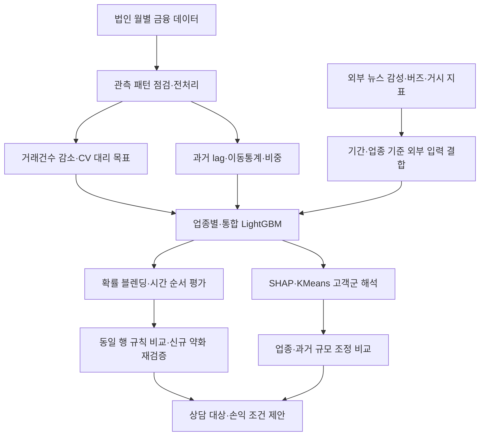

# ML·DL 연결과 사후 검증의 기술적 구성

## 1. 프로젝트의 기술적 중심

목표는 월별 법인 거래에서 활동 약화 신호를 정의하고, 다음 달 상태와 관리 후보를 설명하는 것입니다. 최종 예측기는 LightGBM이며, DL은 보고서상 뉴스 감성지수를 만드는 KoBERT 단계에 해당합니다. 현재 저장소는 노트북·배치 분석 스크립트와 집계 결과로 구성됩니다. RAG, 생성형 LLM API, 실시간 추론 서버, 운영 배포를 구현했다고 설명하지 않습니다.

이 그림은 당시 분석과 사후 검증의 논리적 연결입니다. 모든 노드를 한 번에 실행하는 배포 시스템은 아닙니다. 특히 사후 재학습에서는 발표·수집 시점이 불명확한 외부 지표를 제외했습니다.

## 2. 전처리와 목표값을 먼저 설계한 이유

완전 관측 고객만 사용하면 표본이 크게 줄고, 관측되지 않은 달을 모두 거래 0으로 처리하면 실제 활동과 데이터 누락을 혼동합니다. 따라서 원본은 월별 관측 여부를 배열로 만들고 선행·후행 연속 누락과 중간 누락을 구분했습니다. Runs 검정과 `q^gap` 기준을 사용했으며, 후자는 정식 이항검정 p-value와 구분합니다.

실제 해지 정답이 없어 거래건수 변화와 CV를 결합한 대리 목표를 만들었습니다. 논문에서 얻은 부분 이탈의 관점을 법인 금융에 적용한 것이며, 데이터가 다르므로 논문의 타당성을 그대로 승계하지 않습니다. 감소 임계값·CV 기준·OR 결합은 프로젝트 구현 선택입니다.

다음 달 목표로 shift했더라도 그 구성 요소가 전부 미래의 새 정보를 의미하는 것은 아닙니다. 사후 검토에서 감소 조건 일부가 현재까지의 거래건수로 이미 결정됨을 확인했습니다. 이 때문에 전체 F1뿐 아니라 현재 정상 고객의 신규 약화를 분리해 평가했습니다.

## 3. ML과 DL은 어떻게 연결되는가?

| 구성 | 역할 | 확인 범위 |
|---|---|---|
| KoBERT | 보고서상 뉴스 감성 추론으로 외부 감성지수 생성 | 보고서 설명과 감성 입력 CSV·결합 코드 확인. 체크포인트·전체 추론 과정 미확인 |
| 외부 변수 결합 | 업종 버즈·감성·거시 지표를 최종 모델 입력에 추가 | 원본 노트북 결합 단계 확인. 실시간 API 수집·운영은 미구현 |
| LightGBM | 월별 금융 특징을 이용한 활동 약화 분류 | 제출본 학습·평가 코드와 저장 결과, 사후 내부 거래 재학습 확인 |
| SHAP | 모델 예측에 대한 변수 기여 해석 | 원본 저장 그림과 코드. 사후 재학습 모델의 SHAP을 새로 생성한 것은 아님 |
| KMeans | 법인별 평균 SHAP 벡터를 군집화 | 원본 코드·별도 FINAL 작업본의 배정 근거. 사후 분석은 기존 군집을 사용 |

LightGBM이 KoBERT와 하나의 신경망으로 공동 학습되는 구조는 아닙니다. 감성지수를 표형 입력으로 결합하는 구성입니다. 또한 SHAP은 관찰된 모델 반응의 설명이며, 특정 변수가 고객 이탈을 일으켰다는 인과 추정이 아닙니다.

## 4. 모델 구성과 선택 이유

업종별 4개 모델은 업종마다 다른 자금 흐름을 반영하고, 통합 모델은 공통 패턴을 학습합니다. 업종 라우팅은 해당 업종 모델을 선택하는 절차이며 독립적인 새 분류기가 아닙니다. 블렌딩은 업종별·통합 확률을 0.5씩 혼합합니다. 이 가중치가 최적이라는 별도 검증 결과는 없습니다.

시간 순서로 학습·검증·평가를 나누고 검증 F1로 임계값을 정했습니다. 동일 법인이 여러 기간에 존재하므로 기존 고객의 이후 월에 대한 평가입니다. 미관측 신규 기업에 대한 일반화와는 구분합니다.

원본 최종 비교는 업종 라우팅·통합·블렌딩의 세 구성이며 제출본 블렌딩 F1은 0.7793입니다. 별도 FINAL 실행의 0.7770과 발표자료에 남은 다른 실험 수치를 하나의 결과로 합치지 않습니다. 원본 노트북의 `PR_AUC`는 실제 코드가 average precision을 계산하므로 문서에는 AP로 표기했습니다.

## 5. 사후 검증에서 바뀐 기술적 선택

| 설계 요소 | 사후 구현 | 이유 |
|---|---|---|
| 고객 선별·CV 기준 | 2025.05까지 정보로 고정 | 미래 관측으로 과거의 대상·기준을 정하지 않도록 함 |
| 누락 처리 | 평가에 필요한 8개 월 관측 확인 | 대체값이 만든 라벨과 실제 관측을 구분 |
| 시계열 파생 | 과거 방향 lag·이동통계 | 입력 시점 이후 정보 사용 방지 |
| 외부 지표 | 새 비교에서 제외 | 실제 제공 시점을 확인할 수 없었기 때문 |
| 모델 | 업종별 4개·통합 1개, 상태·건수 추가 통합 1개 | 정보 집합에 따른 추가 가치를 분리 |
| 비교 기준 | 상태 유지 규칙 | 복잡한 모델이 단순 기준보다 나은지 확인 |
| 불확실성 | 법인 단위 짝지은 부트스트랩 300회 | 같은 고객의 월별 반복 관측을 고려 |
| 고객군 비교 | 업종×과거 규모 공통 층 직접 표준화 | 집단의 규모·업종 구성 차이 점검 |

이는 원본 전체 파이프라인의 정확한 재현이 아닌, 목표 정의와 모델 계열을 유지한 별도 실험입니다. 11,953개 동일 법인·월 행에서 상태 유지 규칙 F1 0.9111, 상태·건수 추가 모델 0.9132를 얻었습니다. 차이 +0.0021의 95% 부트스트랩 구간은 −0.0010~+0.0047로 우위를 확정할 수 없습니다.

현재 정상인 행의 신규 약화는 499행이며 추가 모델이 77행을 탐지하고 83행을 오경보로 만들었습니다. 이는 전체 검증 F1로 정한 임계값에서의 탐색적 결과입니다. 실제 이탈 방지나 최적 상담 정책의 성능으로 해석하지 않습니다.

## 6. 고객군 해석을 실무 제안으로 연결

기존 고객군의 업종과 과거 예금·여신 규모를 맞추자 여신 차이가 크게 줄었습니다. 따라서 위험군이라는 이유만으로 낮은 가치의 고객이라고 판단하지 않습니다. 반대로 경보가 크다고 모두 같은 유지 혜택을 주는 전략도 뒷받침되지 않습니다.

관리 제안은 데이터 누락 확인, 실제 거래 변화 상담, 과거 기여이익과 개입 가능성에 따른 선별, 비교군을 둔 파일럿 순서입니다. 거래 잔액은 은행 순이익이 아니므로 그대로 수익으로 바꾸지 않습니다. 손익 시나리오는 비용과 순증 유지율을 가정한 계산이며, 모델 Precision을 유지 성공률로 대입하지 않습니다.

## 7. 코드·산출물과 재현 범위

| 파일 | 담당 단계 |
|---|---|
| [원본 모델 노트북](../notebooks/01-original-model.ipynb) | 출력·내부 경로·개별 고객 미리보기를 정리한 원본 모델 논리 |
| [라벨 유틸리티](../src/label_utils.py) | 거래건수 해석·변화율·CV 계산 |
| [라벨 점검](../scripts/audit_labels.py) | 단순 기준·대체 관측·라벨 시간 구조 검토 |
| [모델 재검증](../scripts/revalidate_models.py) | 과거 정보 기반 선별·학습·동일 행 평가·부트스트랩 |
| [고객군 분석](../scripts/analyze_personas.py) | 기존 군집 배정과 비공개 원천 자료의 집계 비교 |
| [고객군 표준화](../scripts/adjust_persona_comparison.py) | 업종·과거 규모 공통 층 비교 |
| [손익 시나리오](../scripts/business_scenarios.py) | 설명용 가정의 손익분기·순편익 계산 |
| [패키지 검증](../scripts/verify_package.py) | 합성 라벨·지표 정합성·구문·문서 링크·텍스트 민감정보 검사 |

기본 집계 검증은 `requirements.txt`, 원본 모델 작업은 `requirements-model.txt`를 참고합니다. 실제 확인 환경은 [환경 기록](validated-environment.json)에 별도로 보존했습니다. 확인되지 않은 KoBERT 학습·추론 의존성을 임의로 추가하지 않았습니다.

실데이터, 고객별 예측·군집 배정, 모델 바이너리, 뉴스 원문, 개인 검토 메모는 공개본에 넣지 않았습니다. 발표자료 공개본은 [발표자료 PDF](presentation.pdf)로 제공합니다. 원본 4쪽 팀원 소개·역할 페이지만 제거했습니다. 표지·마지막 인사와 법인 사례를 포함한 나머지 슬라이드는 마스킹 없이 원본 그대로이며 원래 번호를 유지했습니다. 원본의 통계 표현을 그대로 옮겨 잘못 해석하지 않도록 README에서 구현과 한계를 함께 설명합니다.

